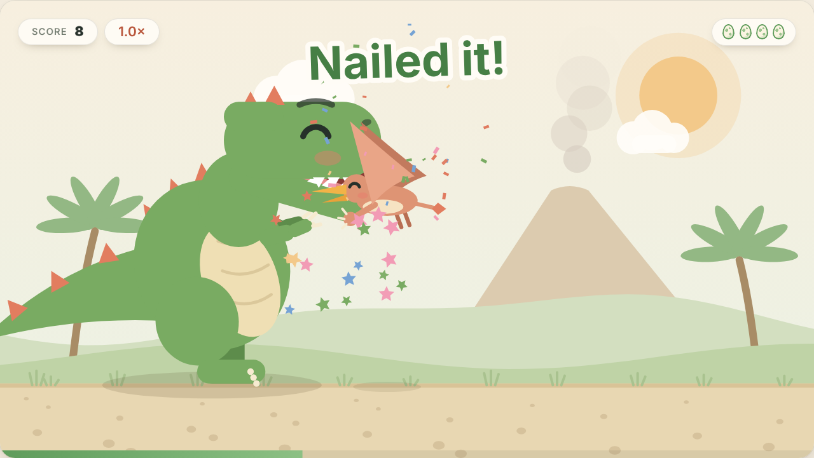
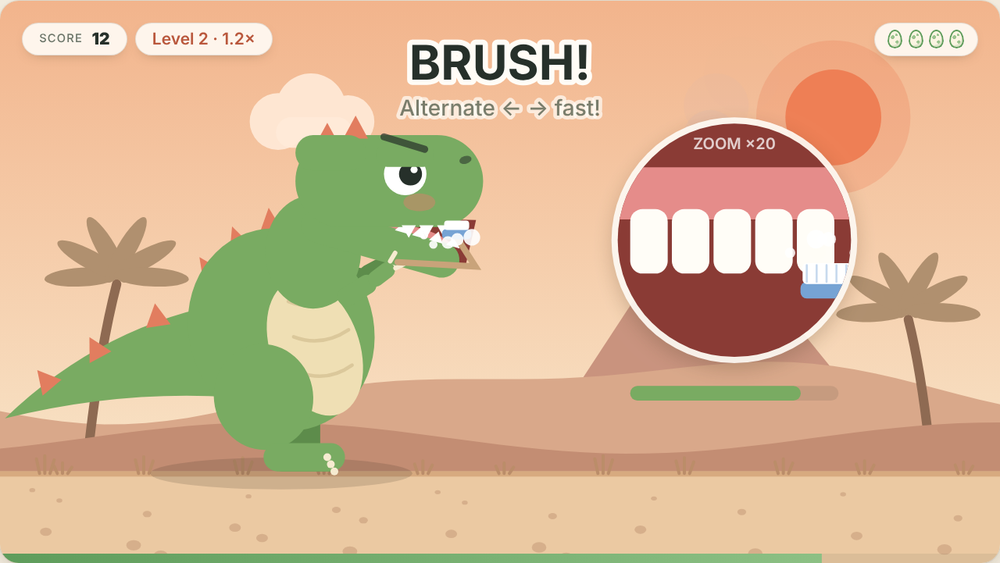
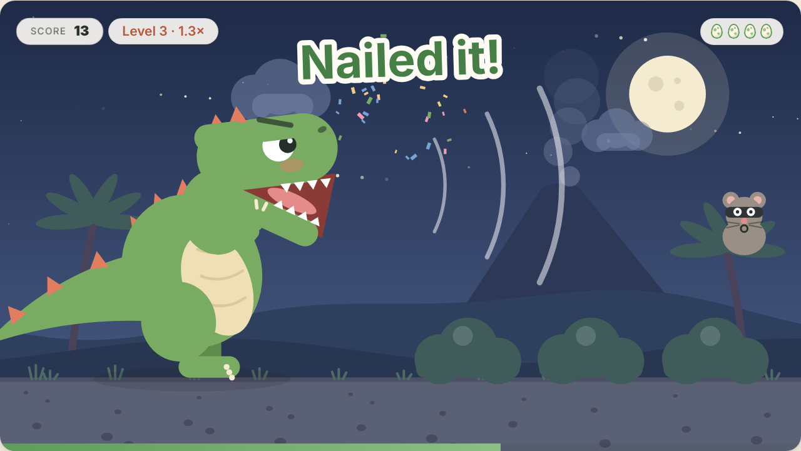
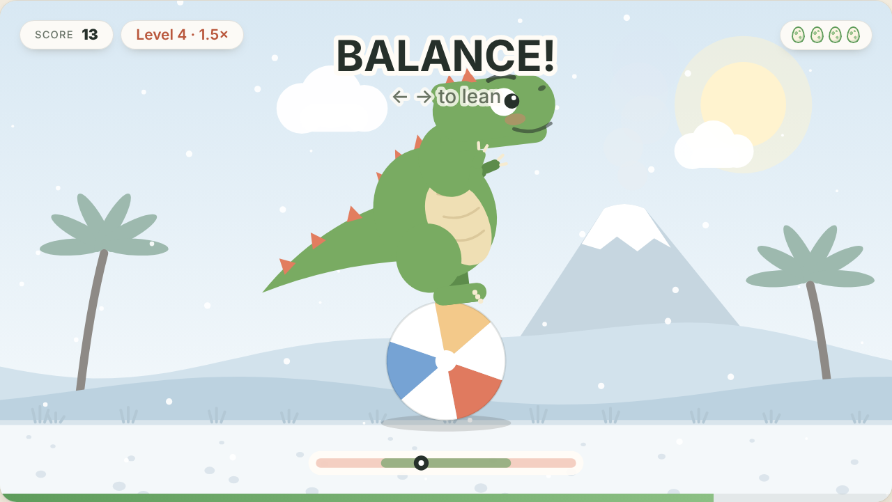
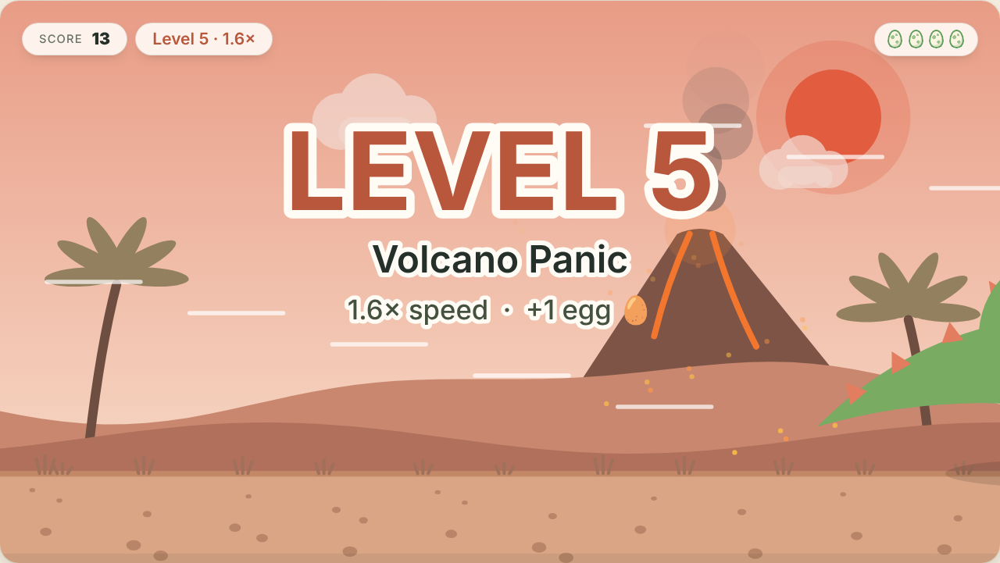

# 🦖 Tiny Arms

**Big dreams. Very short reach.**

Tiny Arms is a fast, funny micro-game party for the browser. You play a T-rex who just wants to do normal things like clap, high-five, brush its teeth or take a selfie, with arms that are about 40 times too short. There are **12 micro-games** across **5 themed worlds**. Each challenge lasts a few seconds, the pace keeps rising, and four misses means extinction.

### ▶ [Play it now](https://mahyadmi.github.io/tiny-arms/)


| | |
|---|---|
|  |  |
|  |  |

---

## The micro-games

| | Challenge | What to do | Control |
|---|---|---|---|
| 👏 | **Clap!** | Mash the button until those tiny hands finally meet | Mash |
| ✋ | **High five!** | A pterodactyl swoops past. Slap when it's in reach | Timing |
| 🍩 | **Catch!** | Get your hands under the falling snack | Move |
| 📸 | **Selfie!** | The selfie stick wobbles. Snap when your face is in frame | Timing |
| ☄️ | **Dodge!** | Meteors! Stay out of the shadows until time runs out | Move / survive |
| 🎂 | **Blow!** | Hold to breathe in, release in the green zone (too much air makes you cough) | Hold & release |
| 🪨 | **Jump!** | A boulder rolls in. Hop over it (two of them on later levels) | Timing |
| ⚖️ | **Balance!** | Stay on top of a beach ball in gusty wind | Lean / survive |
| 🥚 | **Drop!** | The pterodactyl is carrying an egg. Drop it into the nest | Aim & timing |
| 🪥 | **Brush!** | The toothbrush is on a stick. Scrub left and right fast | Wiggle |
| 🎈 | **Stomp!** | Pop every party balloon with your feet | Move & stomp |
| 🦖 | **Roar!** | Scare off the egg thief, but **don't** roar at your baby nephew | Go / no-go |

## Levels and worlds

Every **5 wins** takes you to the next level. The world changes, the game gets faster and the challenges get harder (faster pterodactyls, extra boulders, moving nests, more candles and decoys). You also get back **one bonus egg** (life) if you've lost any.

| Level | World | Speed |
|---|---|---|
| 1 | 🌿 Jurassic Morning | 1.0× |
| 2 | 🌅 Golden Sunset | 1.2× |
| 3 | 🌙 Starry Night | 1.3× |
| 4 | ❄️ Ice Age | 1.5× |
| 5 | 🌋 Volcano Panic | 1.6× |
| 6+ | The worlds repeat (*Jurassic Morning II*…) | up to 2.2× |



Your best score and the highest level you reached are saved in your browser. When the run ends you get a rank, from *Fresh Hatchling* to *Extinction-Proof*.

## Controls

| Action | Keyboard | Mouse / touch |
|---|---|---|
| Action / hold | `Space`, `Enter`, `↑`, `W` | Click or tap the stage |
| Move | `←` `→` or `A` `D` | Move the mouse or drag |
| Pause | `P` or `Esc` | Pause button |
| Mute | `M` | Sound button |

## Features

- **No dependencies, no build step:** plain HTML, CSS and JavaScript (about 3,300 lines)
- **All art is drawn in code** on an HTML5 Canvas, with no image sprites, so it stays sharp on any screen
- **All sound is synthesised** live with the Web Audio API, so there are no audio files
- **Responsive:** desktop, tablet and phone (works best in landscape), on a high-DPI canvas
- **Accessible touches:** full keyboard play, visible focus states, `prefers-reduced-motion` support (no screen shake) and auto-pause when the tab is hidden
- **Polish:** squash-and-stretch, confetti, screen shake, animated level-up transitions with cross-fading worlds, local high score, and Web Share / clipboard score sharing

## Run locally

Any static file server works:

```bash
git clone https://github.com/Mahyadmi/tiny-arms.git
cd tiny-arms
python3 -m http.server 8000
# open http://localhost:8000
```

You can also just open `index.html` in a browser.

## Deploy to GitHub Pages

1. Push the files to the `main` branch of a repository named `tiny-arms`.
2. Go to **Settings → Pages**.
3. Under **Build and deployment**, choose **Deploy from a branch**, then select `main` and `/ (root)`, and save.
4. After a minute the game is live at `https://<your-username>.github.io/tiny-arms/`.

## Project structure

```
tiny-arms/
├── index.html      # Page layout, screens (title, help, pause, game over) and HUD
├── style.css       # Visual design, responsive layout and animations
├── game.js         # Game engine, T-rex renderer, six micro-games, audio and input
├── favicon.svg     # Logo / browser icon
└── assets/         # Screenshots used in this README
```

### How the code is organised

- **Rendering:** a fixed 960×540 logical stage, scaled to fit the screen and the device pixel ratio.
- **`drawRex()`:** one parametric function draws the T-rex (arm angles, eyes, mouth, squash, walk cycle, sweat and so on) and returns where its hand and face are, which the games use for hit detection.
- **Micro-games:** each one is a small object with `init`, `update` and `draw` methods, so adding a new one only means appending to the `GAMES` array.
- **Worlds:** each world is a small colour palette in the `THEMES` array, plus optional effects (stars, snow, lava, embers).
- **Game flow:** a simple state machine: `title → intro → play → result → (level-up) → … → over`.

## Credits

Designed and built by **[Mahyad Mirzabagheri](https://mahyadmi.github.io)**. Also see [OrbitLab](https://github.com/Mahyadmi/OrbitLab).

Font: [Fredoka](https://fonts.google.com/specimen/Fredoka) (SIL Open Font License), with system fallbacks.

## License

[MIT](LICENSE)
