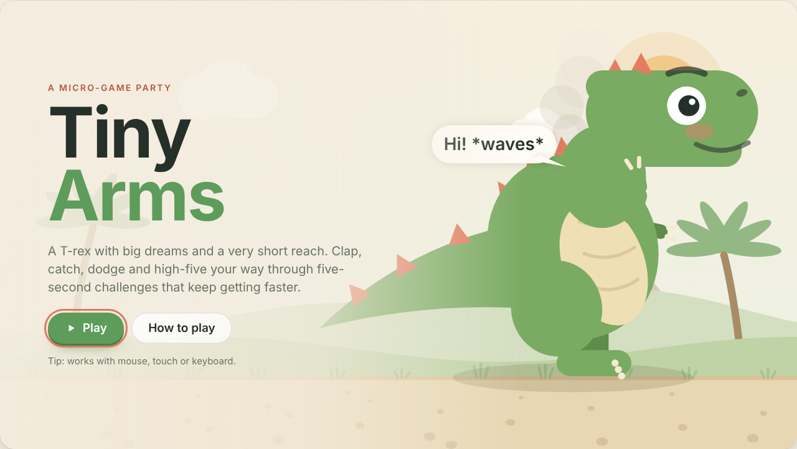
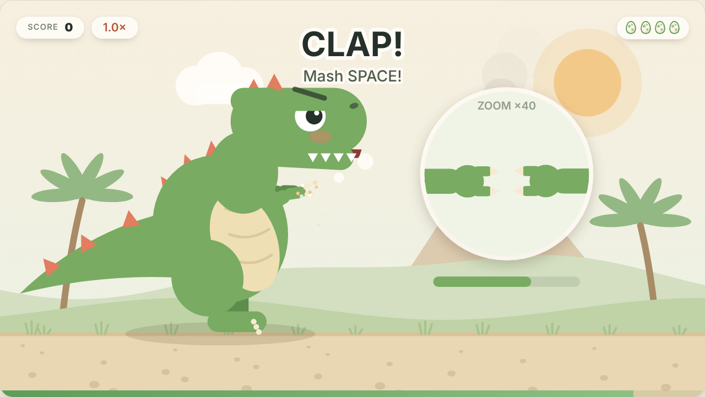

# 🦖 Tiny Arms

**Big dreams. Very short reach.**

Tiny Arms is a fast, funny micro-game party for the browser. You play a T-rex who just wants to do normal things like clap, high-five or take a selfie, with arms that are about 40 times too short. Each challenge lasts a few seconds, the pace keeps rising, and four misses means extinction.

### ▶ [Play it now](https://mahyadmi.github.io/tiny-arms/)



| | |
|---|---|
|  |  |

---

## The micro-games

| | Challenge | What to do |
|---|---|---|
| 👏 | **Clap!** | Mash the button until those tiny hands finally meet |
| ✋ | **High five!** | A pterodactyl swoops past. Slap when it's in reach |
| 🍩 | **Catch!** | Get your hands under the falling snack (donut, egg or cupcake) |
| 📸 | **Selfie!** | The selfie stick wobbles. Snap when your face is in frame |
| ☄️ | **Dodge!** | Meteors! Stay out of the shadows until time runs out |
| 🎂 | **Blow!** | Hold to breathe in, then release in the green zone. Too much air makes you cough |

Every 5 wins the game **speeds up**, and later rounds get harder (faster friends, more meteors, more candles). Your best score is saved in your browser, and when the run ends you get a rank, from *Fresh Hatchling* to *Extinction-Proof*.

## Controls

| Action | Keyboard | Mouse / touch |
|---|---|---|
| Action / hold | `Space`, `Enter`, `↑`, `W` | Click or tap the stage |
| Move | `←` `→` or `A` `D` | Move the mouse or drag |
| Pause | `P` or `Esc` | Pause button |
| Mute | `M` | Sound button |

## Features

- **No dependencies, no build step:** plain HTML, CSS and JavaScript (about 2,500 lines)
- **All art is drawn in code** on an HTML5 Canvas, with no image sprites, so it stays sharp on any screen
- **All sound is synthesised** live with the Web Audio API, so there are no audio files
- **Responsive:** desktop, tablet and phone (works best in landscape), on a high-DPI canvas
- **Accessible touches:** full keyboard play, visible focus states, `prefers-reduced-motion` support (no screen shake) and auto-pause when the tab is hidden
- **Polish:** squash-and-stretch, confetti, screen shake, speed-up interludes, local high score, and Web Share / clipboard score sharing

## Run locally

Any static file server works:

```bash
git clone https://github.com/Mahyadmi/tiny-arms.git
cd tiny-arms
python3 -m http.server 8000
# open http://localhost:8000
```

You can also just open `index.html` in a browser.

## Deploy to GitHub Pages

1. Push the files to the `main` branch of a repository named `tiny-arms`.
2. Go to **Settings → Pages**.
3. Under **Build and deployment**, choose **Deploy from a branch**, then select `main` and `/ (root)`, and save.
4. After a minute the game is live at `https://<your-username>.github.io/tiny-arms/`.

## Project structure

```
tiny-arms/
├── index.html      # Page layout, screens (title, help, pause, game over) and HUD
├── style.css       # Visual design, responsive layout and animations
├── game.js         # Game engine, T-rex renderer, six micro-games, audio and input
├── favicon.svg     # Logo / browser icon
└── assets/         # Screenshots used in this README
```

### How the code is organised

- **Rendering:** a fixed 960×540 logical stage, scaled to fit the screen and the device pixel ratio.
- **`drawRex()`:** one parametric function draws the T-rex (arm angles, eyes, mouth, squash, walk cycle, sweat and so on) and returns where its hand and face are, which the games use for hit detection.
- **Micro-games:** each one is a small object with `init`, `update` and `draw` methods, so adding a new one only means appending to the `GAMES` array.
- **Game flow:** a simple state machine: `title → intro → play → result → (speed-up) → … → over`.

## Credits

Designed and built by **[Mahyad Mirzabagheri](https://mahyadmi.github.io)**. Also see [OrbitLab](https://github.com/Mahyadmi/OrbitLab).

Font: [Fredoka](https://fonts.google.com/specimen/Fredoka) (SIL Open Font License), with system fallbacks.

## License

[MIT](LICENSE)
